# ContextMD map

The parts of ContextMD and how they connect. Chromeria's Map tab colours each part
from GitHub: planned, working, broken or done.

Each part is declared once as `ID["Name"]`. The comment line `%% ID: refs` under it
names the part's Issues and pull requests; the first ref is the primary ref, which
decides planned, working or done. `%% ID: context` marks a part this project draws
but does not track. GitHub ignores these comment lines.

Change this map in the pull request that adds, splits, merges or removes a part.

The target architecture is [#84](https://github.com/toolboxmd/contextmd/issues/84).
It supports the Objective by connecting captured knowledge to serving and feeding
serving misses back into capture. Parts describe the agreed design; their primary
refs show delivery state. Open tests decide the remaining choices before building.

```mermaid
flowchart TB
    subgraph L1["1 Always served"]
        A1["Global AGENTS.md: loaded by the harness"]
        %% A1: context
        A2["PREFERENCES.md: hook, at most 4,000 characters"]
        %% A2: context
        A3["Promachos persona AGENTS.md: Promachos mode only"]
        %% A3: context
        GL["Great Library pointer: first message and after compaction"]
        %% GL: #83 #34 PR #74 toolboxmd/chromeria#311
    end

    subgraph L2["2 Capture"]
        R["Agent Observer: one ledger per machine, text in native logs"]
        %% R: context
        P["Preparation: cut sessions into segments"]
        %% P: #7
        C["Extract locally on each machine: candidate knowledge"]
        %% C: #7 PR #22
        Q["One capture queue: all machines, one writer, session-date order"]
        %% Q: #77 #42
        MC["Capture on every machine, scheduled"]
        %% MC: #42
        NC["Non-code capture"]
        %% NC: #35
        R --> P --> C --> Q
        MC -.-> C
        NC -.-> C
    end

    subgraph L3["3 Store"]
        U["Update: search cards, add / update / refresh / remove"]
        %% U: #77 #8 #9 #10
        W["Write: final body and card, right owner, one repo"]
        %% W: #77 PR #44 #39
        CF["Search-card item format: short body or card plus target"]
        %% CF: #84 #19 #41
        ST["Great Library store"]
        %% ST: context
        SL["Satrapy Library stores"]
        %% SL: context
        AS["AgentsMD procedure store"]
        %% AS: context
        RB["Runbook store"]
        %% RB: context
        IX["One index: exact keys, searchable card text, Cue fields"]
        %% IX: #84
        U --> W
        CF -.-> W
        W --> ST & SL & AS & RB
        W -->|always-loaded owners, no cards| A1 & A2 & A3
        ST & SL & AS & RB --> IX
        IX -.->|search existing knowledge| U
    end

    subgraph L4["4 Matched serving"]
        M["Moment: user message, tool call or error"]
        %% M: #3
        EK["Exact keys: command / path / error, can block the call"]
        %% EK: #3 #11
        RL["Search: BM25 and vectors over cards"]
        %% RL: #14
        CU["Cue: trained model reads situation text"]
        %% CU: #13 #4 PR #36 toolboxmd/chromeria PR #227
        DB["Decide and budget: dedupe, byte cap, once per epoch"]
        %% DB: #3 #11
        IN["Inject into agent, log and receipt"]
        %% IN: #3 #12
        TS["Tests: item format, search inputs, query, serve gate"]
        %% TS: #14
        MK["Must-know rule before its action"]
        %% MK: toolboxmd/chromeria PR #233 toolboxmd/chromeria#231
        PK["Path keys on shell commands"]
        %% PK: toolboxmd/chromeria#234
        FR["Pointer lifts only on a full read"]
        %% FR: toolboxmd/chromeria PR #226 toolboxmd/chromeria#225
        CK["Command keys fire on runs, not mentions"]
        %% CK: toolboxmd/chromeria#232 toolboxmd/chromeria#284
        RD["Readers called by path; OpenCode reservations"]
        %% RD: toolboxmd/chromeria#221
        FL["Serving on Codex, Grok and OpenCode"]
        %% FL: #12
        GD["Grok deny defects"]
        %% GD: toolboxmd/chromeria#229 toolboxmd/chromeria#230 toolboxmd/chromeria#228
        PT["Pointer-trial retirement"]
        %% PT: #43
        WF["Cue input window format"]
        %% WF: #20
        GH["GPU serving host recovers on its own"]
        %% GH: #6
        SI["Serving health check"]
        %% SI: #40 #64 PR #65
        SR["Serve evidence report"]
        %% SR: PR #38 PR #75 #15
        SC["Serve card and label prompt"]
        %% SC: PR #45 PR #75 #15
        LJ["Outcome labels: irrelevant / wrong / followed / ignored / no governed action"]
        %% LJ: #15
        D["Join serving misses to capture"]
        %% D: #16
        RP["Twice-weekly repeated-correction report"]
        %% RP: #17
        SP["Per-row proof that a serve was shown"]
        %% SP: toolboxmd/chromeria#245 PR #75

        M --> EK & RL & CU
        EK & RL & CU --> DB --> IN
        TS -.-> RL & CU & DB
        EK --- MK & PK & FR & CK & RD
        PT --> EK
        IN --> FL
        FL --- GD
        WF -.-> CU
        GH -.-> CU
        IN --> SI & SR
        SP --> SR
        SR --> SC --> LJ --> D --> RP
    end

    Q --> U
    IX --> EK & RL & CU
    IN -.->|serve logs and refresh receipts| Q
    D -.->|miss feedback| Q
```

The Great Library pointer is always served and never searched. Everything outside
AGENTS.md files and hook-injected context must be servable. Cards live in their
owners' repositories; PREFERENCES and persona have no cards. The update step uses
one model decision to write the final body and card; a refresh writes only a
receipt signalling a serving miss.

[#84](https://github.com/toolboxmd/contextmd/issues/84) supersedes the architecture
sections of #2 and #3. Preparation and extract (#7), machine and non-code capture
(#42, #35), update and write (#77), and feedback (#15, #16, #17) need revision to
this design. Judge calibration (#8), classify (#9) and reflect (#10) are still
open but superseded by U, not separate steps. Waiting items (#19) fold into CF;
the old flat Library format (#41) is supporting history, not the new card format.

## Work that is not a part

Every piece of work on the path to the Objective is a part above, except these:

| Work | Why it is not a part |
| --- | --- |
| First bake (#39) | A run of one lesson through the whole loop, not a piece of it. It is bound on W. |
| Cue shadow scoring (#76, still open) | Deleted by #77's design in #84; retained here until the Issue is closed or revised, not drawn as a planned part. |
| Great Library, Satrapy Libraries, AgentsMD and runbook stores | Drawn as ST, SL, AS and RB, context parts owned outside this repository. |
| "Read in full" wording in AgentsMD (toolboxmd/agentsmd#224, merged) | AgentsMD's own change, inside the AS context part. |
| Agent Observer event search and lock failures (toolboxmd/agent-observer#70, #71, done) | Agent Observer's own work, inside the R context part. |
