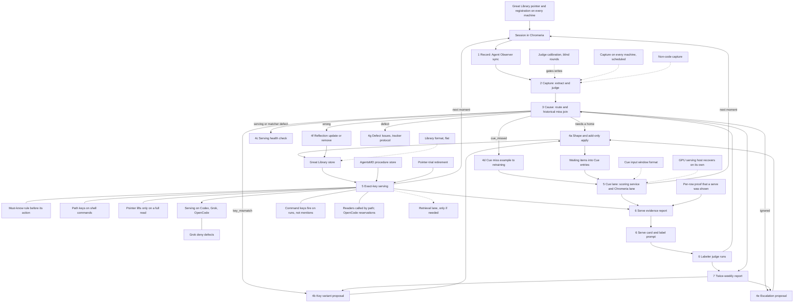

# ContextMD map

The parts of ContextMD and how they connect. Chromeria's Map tab colours each part
from GitHub: planned, working, broken or done.

Each part is declared once as `ID["Name"]`. The comment line `%% ID: refs` under it
names the part's Issues and pull requests; the first ref is the primary ref, which
decides planned, working or done. `%% ID: context` marks a part this project draws
but does not track. GitHub ignores these comment lines.

Change this map in the pull request that adds, splits, merges or removes a part.

## Work that is not a part

Every piece of work on the path to the Objective is a part above, except these:

| Work | Why it is not a part |
| --- | --- |
| First bake (#39) | A run of one lesson through the whole loop, not a piece of it. It is bound on W. |
| Great Library flat store | Drawn as ST, a context part: its tracking lives outside this public repository. |
| "Read in full" wording in AgentsMD (toolboxmd/agentsmd#224, merged) | AgentsMD's own change, inside the AS context part. |
| Agent Observer event search and lock failures (toolboxmd/agent-observer#70, #71, done) | Agent Observer's own work, inside the R context part. |
